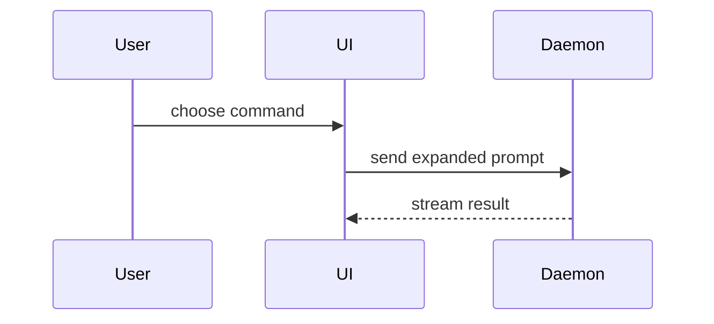

Help the user quickly understand what changed. Choose the smallest visual representation that exposes the relevant behavior, structure, or ownership. Keep it next to the short explanation it supports; omit irrelevant detail.

[//]: # (This initial version adapts the diagramming guidance and examples from `/pr`. The roadmap tracks replacing this copy with a purpose-built skill.)

## Choose a representation

- **Pseudocode** for a changed algorithm or decision flow.
- **Call tree** for runtime control flow or delegation.
- **Component tree** for UI structure, including important state and module boundaries.
- **Shallow file tree** for responsibility changes or a broad refactor.
- **Mermaid** for component interaction, control flow, or data flow.
- **Focused diff** when the point is what changed and the surrounding shape already exists.
- **Whole code block** when most of it is new, omitted context would hide ownership or order, or the user needs a copyable target shape.

Match the view to the change:

```text
on(save)
  if content is unchanged
    return cached result
  write new content
  return fresh result
```

```text
submitForm
  createSession
    persistPrompt
    launchAgent
  navigateToSession
```

```text
<SessionPage>
  useSessionEvents()
  <SessionToolbar>
    <RunSkillButton />
  <SessionTimeline />
```

```text
src/
├── commands/       # parses user actions
├── sessions/       # owns session state
└── transport/      # sends API requests
```



```diff
 <SessionPage>
   useSessionEvents()
   <SessionToolbar>
+    <RunSkillButton />
   <SessionTimeline>
+    <SkillResultCard />
```

```diff
 src/
 ├── commands/
+│   └── show-me.ts       # expands the slash command
 ├── sessions/
-└── transport.ts
+└── transport/
+    ├── client.ts
+    └── stream.ts
```

```diff
 submitForm
   createSession
     persistPrompt
+    expandSkillCommand
     launchAgent
-  navigateToSession
+  navigateToSession
+    subscribeToEvents
```

```ts
function expandSkill(command: string): string {
  const skillName = command.slice(1);
  return `use the ${skillName} skill`;
}
```

```diff
 on(save)
-  write content
+  if content is unchanged
+    return cached result
+  write new content
+  invalidate cache
```

For component, file-layout, or call-tree changes, show only the relevant additions, removals, and ownership. Show unchanged neighbors only when needed to make the change clear.
Use one representation or several only when each adds clarity; avoid overwhelming the user with redundant views.

## Boundaries

- Base the explanation on the supplied diff and verified code context. Mark uncertainty; do not invent unseen structure.
- Explain the change, not whether it is correct. Use `/joint-code-review` for a review.
- Do not force a diagram when a concise diff or plain explanation is clearer.
