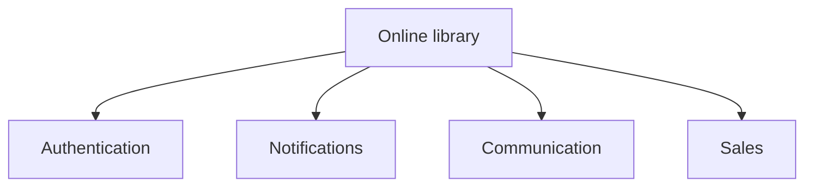
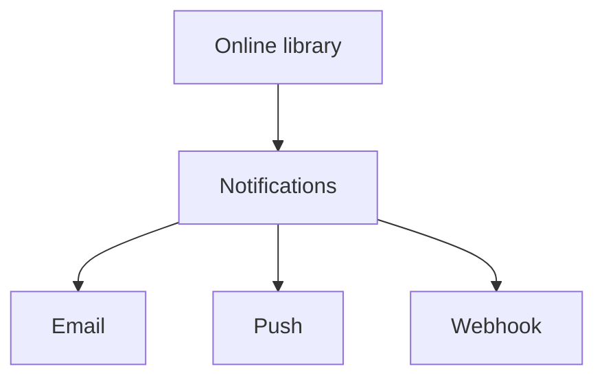
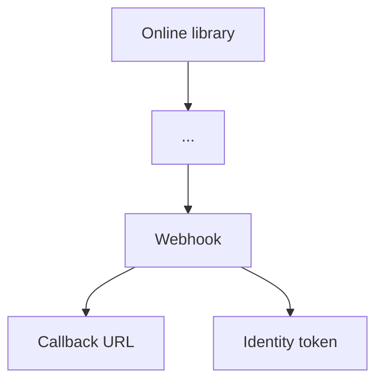

## Principle

Software engineering compresses complexity into forms people can reason about. At the same time, people and agents have a limited context window: the information that must be kept in mind at once has a cost. Structure software as a collection of centers so each level stays useful, connected, and within that information budget.

This applies to both the application's source code and its user interface.

## Constant density

Keep information dense: present the core information without filler, and include enough context to make the right connections and prime sound reasoning. The goal is a useful density throughout the application, not the fewest possible words or details.

## Information budget

People can only keep so much information at the front of their minds. The more they must hold at once, the more effort it takes to reason well. The information budget is the amount of information someone needs to keep in mind to reason about a system at a given level.

Keep a level within that budget by delegating details to lower-level centers, while retaining the context needed to understand how centers relate. Treat width and depth as design heuristics, not fixed limits: adjust them until each center is understandable without losing important connections.

## A tree of constant density and increasing fidelity

View the application at different levels of fidelity:

- At a high level, describe how centers relate and what they are responsible for.
- At lower levels, reveal the details delegated by the level above: exact data mutations, edge cases, and interaction behavior.
- At the leaves, show implementation-level detail.

Keep each level dense enough to support its decisions. Increase fidelity as you move toward the leaves; otherwise abstraction can hide the information needed to understand or change the system. Higher levels should delegate implementation choices they do not need to reason about. For example, a high-level design may need to know that one area requires authentication and another is public, while the login flow and permission checks belong to lower-level centers.

## Centers and dependencies

Group related behavior into centers that can be understood as standalone elements. Domain models and modules form branches; specific implementations form leaves; the application as a whole forms the root. Keep the width and depth of these groups appropriate to the information budget rather than enforcing numeric caps.

Keep architectural dependencies mostly one-directional, from higher-level centers toward lower-level centers. Minimize the seams between centers, and favor top-down relationships over dependencies that reach back upward or sideways between peers. This is an architectural direction, not a requirement that runtime control flow always follow the same path.

The following sequence shows one application at increasing fidelity. Each step expands a center along a path from the root; unrelated branches are omitted, and `...` marks parent centers hidden from the focused view.

### Whole application

### Notifications as a center

### Webhook at greater fidelity

Here, `...` stands for the omitted parent center or centers between the root and the focused center.
